<!--
  이 README의 터미널 이미지(assets/*.svg)는 GitHub Actions가 매일 다시 그려요.
  소개 문구는 profile.yml 에서 고치세요. 이미지 파일을 직접 고치면 다음 실행 때 덮어써져요.
-->

<picture>
  <source media="(prefers-color-scheme: dark)" srcset="assets/hero-dark.svg">
  
</picture>

  <a href="https://hits.sh/github.com/Artiffect/">
    <picture>
      <source media="(prefers-color-scheme: dark)" srcset="https://hits.sh/github.com/Artiffect.svg?style=for-the-badge&label=VISITORS&color=f08ac0&labelColor=161616">
      
    </picture>
  </a>
  <a href="https://artiffect.github.io">
    <picture>
      <source media="(prefers-color-scheme: dark)" srcset="https://img.shields.io/badge/Blog-artiffect.github.io-c3a6e6?style=for-the-badge&logo=astro&logoColor=white&labelColor=161616">
      
    </picture>
  </a>
  <a href="mailto:ak501636@gmail.com">
    <picture>
      <source media="(prefers-color-scheme: dark)" srcset="https://img.shields.io/badge/Mail-Gmail-f7c1dc?style=for-the-badge&logo=gmail&logoColor=white&labelColor=161616">
      
    </picture>
  </a>

<picture>
  <source media="(prefers-color-scheme: dark)" srcset="assets/btop-dark.svg">
  
</picture>

<picture>
  <source media="(prefers-color-scheme: dark)" srcset="assets/h01-dark.svg">
  
</picture>

<picture>
  <source media="(prefers-color-scheme: dark)" srcset="assets/stack-dark.svg">
  
</picture>

<picture>
  <source media="(prefers-color-scheme: dark)" srcset="assets/h02-dark.svg">
  
</picture>

  <picture>
    <source media="(prefers-color-scheme: dark)" srcset="https://github-readme-stats.vercel.app/api?username=Artiffect&show_icons=true&custom_title=Artiffect%27s%20GitHub%20Stats&bg_color=161616&title_color=f08ac0&icon_color=c3a6e6&text_color=e6e6e6&ring_color=f08ac0&border_color=333333">
    
  </picture>
  <picture>
    <source media="(prefers-color-scheme: dark)" srcset="https://streak-stats.demolab.com?user=Artiffect&background=161616&border=333333&stroke=333333&ring=f08ac0&fire=f08ac0&currStreakNum=e6e6e6&sideNums=e6e6e6&currStreakLabel=f08ac0&sideLabels=c3a6e6&dates=7a7a7a">
    
  </picture>

<picture>
  <source media="(prefers-color-scheme: dark)" srcset="assets/h03-dark.svg">
  
</picture>

<picture>
  <source media="(prefers-color-scheme: dark)" srcset="https://github-readme-activity-graph.vercel.app/graph?username=Artiffect&custom_title=Artiffect%27s%20Contribution%20Graph&bg_color=161616&color=c3a6e6&line=f08ac0&point=e6e6e6&area_color=f08ac0&title_color=f08ac0&area=true&hide_border=true">
  
</picture>

<picture>
  <source media="(prefers-color-scheme: dark)" srcset="assets/h04-dark.svg">
  
</picture>

<picture>
  <source media="(prefers-color-scheme: dark)" srcset="assets/gitlog-dark.svg">
  
</picture>

<picture>
  <source media="(prefers-color-scheme: dark)" srcset="assets/h05-dark.svg">
  
</picture>

  <picture>
    <source media="(prefers-color-scheme: dark)" srcset="assets/spotify-dark.svg">
    
  </picture>

<picture>
  <source media="(prefers-color-scheme: dark)" srcset="assets/footer-dark.svg">
  
</picture>
